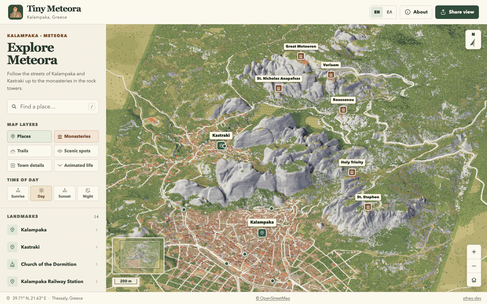

# Tiny Meteora

An interactive pixel-art atlas of Kalampaka, Kastraki, and the Meteora monasteries. Explore in English or Greek, toggle animated life and trails, and switch between sunrise, day, sunset, and night.



Live demo: https://tiny-meteora.stheo.dev

## Run the map

```sh
python3 -m http.server 4173 --bind 127.0.0.1 --directory dist
```

Open [the local map](http://127.0.0.1:4173/). The rendered map is included in `dist/` and runs without API keys, a build step, or source data downloads.

## Render your own map

Use Python 3, a C compiler available as `cc`, and Pillow with WebP support. Download the [2016 Meteora scan](https://zenodo.org/records/10379319), file `816105d6666843369c1af8e5427e56cf.glb`, and save it as `cache/meteora-2016.glb`. Its published MD5 is `8272c04e4a8a6c3ea03c2a8da4d33e8b`.

Fetch the OpenStreetMap extract and 16 elevation tiles once. These inputs are ignored by Git. A fresh OSM download may differ from the snapshot used for the bundled render.

```sh
(
  set -e
  mkdir -p cache data/terrain
  curl -fLsS 'https://api.openstreetmap.org/api/0.6/map?bbox=21.581,39.681,21.654,39.746' \
    -o cache/kalampaka.osm
  gzip -n -c cache/kalampaka.osm > data/kalampaka.osm.gz
  for x in 4586 4587 4588 4589; do
    for y in 3107 3108 3109 3110; do
      curl -fLsS "https://s3.amazonaws.com/elevation-tiles-prod/terrarium/13/${x}/${y}.png" \
        -o "data/terrain/${x}-${y}.png"
    done
  done
)
```

Set up the renderer and run a basic render into an ignored preview directory.

```sh
python3 -m venv .venv
.venv/bin/python -m pip install -r requirements.txt
.venv/bin/python scripts/render_scan_map.py --scan cache/meteora-2016.glb \
  --output prototype/scan-preview/assets
cp dist/index.html dist/atlas.css dist/atlas.js dist/i18n.js dist/scene-life.js prototype/scan-preview/
cp dist/assets/atlas-cover.webp dist/assets/favicon.png prototype/scan-preview/assets/
python3 -m http.server 4174 --bind 127.0.0.1 --directory prototype/scan-preview
```

Open [the render preview](http://127.0.0.1:4174/). To make it the bundled map, review the output and rerun with `--output dist/assets`. Refresh the About credits if the data sources change.

### Higher-quality rooftops

**Google Solar API can be used to produce higher-quality rooftop rendering.** Supply your own permitted RGB, DSM, and building-mask GeoTIFF files, in matching `*_rgb.tif`, `*_dsm.tif`, and `*_mask.tif` triplets aligned to north-up WGS84 / UTM zone 34N. Keep them in `cache/google/`. The renderer reads local files, so it never needs your credentials. [Solar data layers](https://developers.google.com/maps/documentation/solar/geotiff) · [Solar API policies](https://developers.google.com/maps/documentation/solar/policies)

```sh
.venv/bin/python scripts/render_scan_map.py --scan cache/meteora-2016.glb \
  --roof-survey cache/google
```

This command makes a standalone viewer at `prototype/solar-roof-preview/`. Serve that directory with `python3 -m http.server 4174 --bind 127.0.0.1 --directory prototype/solar-roof-preview`.

## Contribute

Edit the static viewer in `dist/`, bilingual landmark records in `data/places.json`, or the rendering pipeline in `scripts/`. See [AGENTS.md](AGENTS.md) for the project layout and verification steps. The optional Wrangler config serves the static viewer and leaves public hostnames and previews disabled by default.

## License and map sources

- The project code is [MIT-licensed](LICENSE). The license does not grant rights to third-party data or bundled map artwork.
- The map uses [Meteora, Greece](https://zenodo.org/records/10379319) by Fotis Giagkas, [CC BY 4.0](https://creativecommons.org/licenses/by/4.0/). The scan was aligned, retextured, and rendered with added geometry and vegetation.
- Street and feature data © [OpenStreetMap contributors](https://www.openstreetmap.org/copyright), under the [ODbL](https://opendatacommons.org/licenses/odbl/1-0/). The raw extract is fetched locally. The viewer includes derived map and animation data.
- Elevation comes from [Mapzen Terrain Tiles](https://registry.opendata.aws/terrain-tiles/). The European data was produced using Copernicus data and information funded by the European Union, EU-DEM layers. [Terrain source notices](https://github.com/tilezen/joerd/blob/master/docs/attribution.md)
